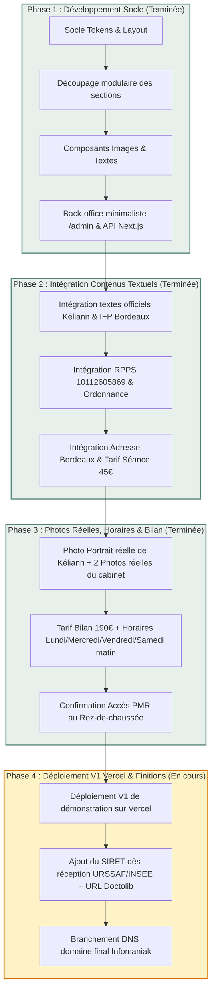

# Product Requirement Document (PRD)

## Projet : Site Vitrine Professionnel - Kéliann L'Azou, Psychomotricien D.E.
- **Statut :** Phase 3 Terminée — Contenus & Photos Réels 100% Intégrés (Prêt pour Déploiement V1 Vercel)
- **Auteur :** Tech Lead & Product Architect
- **Cible immédiate :** Prévisualisation localhost & Déploiement V1 sur Vercel (`.vercel.app`)
- **Cible finale :** Connexion au nom de domaine définitif (Infomaniak) + ajout SIRET & lien Doctolib
- **Version :** 1.3.0

---

## 1. Résumé Exécutif & Vision Produit

### 1.1 Contexte & Mission
Kéliann L'Azou est Psychomotricien Diplômé d'État (D.E.), formé à l'IFP de Bordeaux (RPPS : `10112605869`). La psychomotricité est une profession paramédicale réglementée par le Code de la Santé Publique, exercée sur prescription médicale obligatoire.

Son cabinet est situé au **73 Av. Louis Barthou, 33200 Bordeaux** (rez-de-chaussée, entièrement accessible PMR, accès par interphone).

L'objectif principal du projet est de doter Kéliann d'une présence en ligne professionnelle, sobre, rassurante et ultra-performante. Le site sert de vitrine de réassurance pour les patients (enfants, adolescents, adultes, seniors), leurs familles et le réseau médical/paramédical bordelais.

### 1.2 Objectifs Stratégiques
1. **Clarté pédagogique :** Démystifier la psychomotricité auprès du grand public à travers une ergonomie visuelle claire (présentation, valeurs clés, 8 motifs de consultation).
2. **Conversion sans friction :** Guider l'utilisateur vers la prise de rendez-vous en ligne via **Doctolib** ou par contact direct (`06 52 58 85 17` / `lazoukeliann.psychomot@gmail.com`).
3. **Point d'atterrissage carte de visite :** Assurer une vitesse d'affichage instantanée lors du scan du **QR Code** imprimé sur les cartes de visite professionnelles.
4. **Zéro friction technique & Back-office intégré :** Maintenir une maintenance quasi-nulle pour le praticien, avec un panneau d'administration minimaliste (`/admin`) propulsé par les API Routes Next.js permettant d'éditer les coordonnées, horaires, tarifs, identifiants légaux (SIRET, RPPS) et une bannière d'information temporaire.

---

## 2. Feuille de Route & Phasing du Projet (Roadmap)

---

## 3. Matrice des Contenus Client (État d'Avancement Phase 3)

| Catégorie | Élément | Statut | Valeur Intégrée |
| :--- | :--- | :--- | :--- |
| **1. Identité légale & Santé** | Titre professionnel | ✅ **Intégré** | *Kéliann L'Azou – Psychomotricien Diplômé d'État (IFP de Bordeaux)* |
| | Numéro RPPS | ✅ **Intégré** | `10112605869` (Attestation ARS du 30/08/2026) |
| | Numéro SIRET | ⏳ **En cours** | Micro-entreprise créée, en attente de réception du numéro SIRET d'ici quelques jours (modifiable via `/admin`) |
| | Formule d'ordonnance | ✅ **Intégré** | *« Je prescris la réalisation d’un bilan psychomoteur pour [nom de la personne], suivi si nécessaire d’une prise en charge en psychomotricité selon les conclusions du bilan. »* |
| **2. Pratique & Textes** | Section « Qui suis-je ? » | ✅ **Intégré** | Texte complet en 5 paragraphes + accueil et conclusion |
| | 3 Valeurs clés | ✅ **Intégré** | 1. *Individualité* • 2. *Bienveillance* • 3. *Respect du rythme* |
| | Citation | ✅ **Intégré** | *« Accompagner, ce n'est pas montrer le chemin, c'est aider chacun à trouver le sien. »* |
| | 8 Motifs de consultation | ✅ **Intégré** | Graphisme/écriture, Coordination/dyspraxie, Motricité fine, Équilibre/motricité globale, Repérage espace/temps, Particularités sensorielles, Confiance en soi/vécu corporel, Développement psychomoteur |
| **3. Tarifs & Remboursements** | Tarif Séance de suivi | ✅ **Intégré** | **45 €** (Durée : **45 minutes**) |
| | Tarif Bilan complet | ✅ **Intégré** | **190 €** (modifiable à tout moment depuis `/admin`) |
| | Note mutuelles / aides | ✅ **Intégré** | Texte explicatif clair (Assurance Maladie, mutuelles, MDPH, PCO) |
| **4. Accès & Contact** | Adresse physique & PMR | ✅ **Intégré** | **73 Av. Louis Barthou, 33200 Bordeaux** (Rez-de-chaussée • Accessible PMR • Accès par interphone) |
| | Lien Google Maps | ✅ **Intégré** | Lien direct Google Maps actif vers le 73 Av. Louis Barthou, 33200 Bordeaux |
| | Coordonnées directes | ✅ **Intégré** | `06 52 58 85 17` / `lazoukeliann.psychomot@gmail.com` |
| | Horaires d'ouverture | ✅ **Intégré** | **Lundi, Mercredi, Vendredi :** `09h15 – 13h00 / 14h15 – 18h00` • **Samedi :** `09h15 – 13h00` • **Mardi, Jeudi, Dimanche :** `Fermé` |
| | Profil Doctolib | ⏳ **En attente** | Pointe vers Doctolib générique en attendant l'URL exacte de la fiche praticien |
| **5. Photos & Médias (HD)** | 1. Portrait de Kéliann | ✅ **Intégré** | Photo réelle intégrée (`/images/keliann-portrait.jpg`) |
| | 2. Salle de consultation | ✅ **Intégré** | Photo réelle n°1 du cabinet intégrée (`/images/cabinet-2.jpg`) |
| | 3. Espace d'accueil & bureau | ✅ **Intégré** | Photo réelle n°2 du cabinet intégrée (`/images/cabinet-1.jpg`) |

---

## 4. Derniers Éléments Restants (Post-V1 Vercel)

1. **Numéro SIRET :** Micro-entreprise créée ; dès réception du courrier INSEE/URSSAF d'ici quelques jours, il pourra être saisi directement dans `/admin` (ou dans `default-settings.json`).
2. **Lien URL Doctolib :** À remplacer dès que la fiche praticien Doctolib de Kéliann est ouverte.
