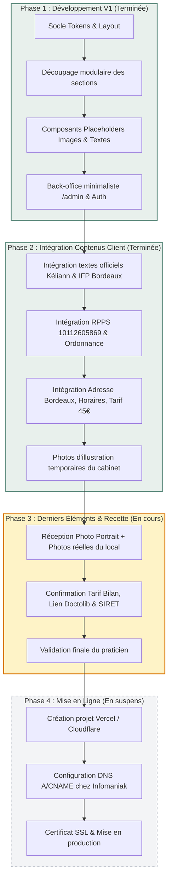

# Product Requirement Document (PRD)

## Projet : Site Vitrine Professionnel - Kéliann L'Azou, Psychomotricien D.E.
- **Statut :** Phase 2/3 — Contenus Réels Intégrés & Recette Visuelle
- **Auteur :** Tech Lead & Product Architect
- **Cible immédiate :** Environnement local & Prévisualisation client avec données officielles
- **Cible finale (en attente validation finale) :** Déploiement Cloud (Vercel / Cloudflare) & Domaine Infomaniak
- **Version :** 1.2.0

---

## 1. Résumé Exécutif & Vision Produit

### 1.1 Contexte & Mission
Kéliann L'Azou est Psychomotricien Diplômé d'État (D.E.), formé à l'IFP de Bordeaux (RPPS : `10112605869`). La psychomotricité est une profession paramédicale réglementée par le Code de la Santé Publique, exercée sur prescription médicale obligatoire.

Son cabinet est situé au **73 Av. Louis Barthou, 33200 Bordeaux** (rez-de-chaussée, accès par interphone).

L'objectif principal du projet est de doter Kéliann d'une présence en ligne professionnelle, sobre, rassurante et ultra-performante. Le site doit servir de vitrine de réassurance pour les patients (enfants, adolescents, adultes, seniors), leurs familles et le réseau médical/paramédical bordelais.

### 1.2 Objectifs Stratégiques
1. **Clarté pédagogique :** Démystifier la psychomotricité auprès du grand public à travers une ergonomie visuelle claire (présentation, valeurs clés, 8 motifs de consultation).
2. **Conversion sans friction :** Guider l'utilisateur vers la prise de rendez-vous en ligne via **Doctolib** ou par contact direct (`06 52 58 85 17` / `lazoukeliann.psychomot@gmail.com`).
3. **Point d'atterrissage carte de visite :** Assurer une vitesse d'affichage instantanée lors du scan du **QR Code** imprimé sur les cartes de visite professionnelles.
4. **Zéro friction technique & No-Overengineering :** Maintenir une maintenance quasi-nulle pour le praticien, avec un panneau d'administration minimaliste (`/admin`) permettant d'éditer les coordonnées, horaires, tarifs, identifiants légaux et une bannière d'information temporaire.

---

## 2. Feuille de Route & Phasing du Projet (Roadmap)

---

## 3. Matrice des Contenus Client (État d'Avancement Phase 2/3)

| Catégorie | Élément | Statut | Valeur Intégrée / Reste à fournir |
| :--- | :--- | :--- | :--- |
| **1. Identité légale & Santé** | Titre professionnel | ✅ **Intégré** | *Kéliann L'Azou – Psychomotricien Diplômé d'État (IFP de Bordeaux)* |
| | Numéro RPPS | ✅ **Intégré** | `10112605869` (Attestation ARS du 30/08/2026) |
| | Numéro SIRET | ⏳ **En attente** | *En cours d'immatriculation (à renseigner via `/admin` dès réception)* |
| | Formule d'ordonnance | ✅ **Intégré** | *« Je prescris la réalisation d’un bilan psychomoteur pour [nom de la personne], suivi si nécessaire d’une prise en charge en psychomotricité selon les conclusions du bilan. »* |
| **2. Pratique & Textes** | Section « Qui suis-je ? » | ✅ **Intégré** | Texte complet en 5 paragraphes + accueil et conclusion |
| | 3 Valeurs clés | ✅ **Intégré** | 1. *Individualité* • 2. *Bienveillance* • 3. *Respect du rythme* |
| | Citation | ✅ **Intégré** | *« Accompagner, ce n'est pas montrer le chemin, c'est aider chacun à trouver le sien. »* |
| | 8 Motifs de consultation | ✅ **Intégré** | Graphisme/écriture, Coordination/dyspraxie, Motricité fine, Équilibre/motricité globale, Repérage espace/temps, Particularités sensorielles, Confiance en soi/vécu corporel, Développement psychomoteur |
| **3. Tarifs & Remboursements** | Tarif Séance de suivi | ✅ **Intégré** | **45 €** (Durée : **45 minutes**) |
| | Tarif Bilan complet | ⏳ **En attente** | Affiché *« À définir »* (en attente d'alignement avec les confrères du secteur) |
| | Note mutuelles / aides | ✅ **Intégré** | Texte explicatif clair (Assurance Maladie, mutuelles, MDPH, PCO) |
| **4. Accès & Contact** | Adresse physique | ✅ **Intégré** | **73 Av. Louis Barthou, 33200 Bordeaux** (Rez-de-chaussée • Interphone) |
| | Lien Google Maps | ✅ **Intégré** | Lien direct Google Maps actif vers le 73 Av. Louis Barthou, 33200 Bordeaux |
| | Coordonnées directes | ✅ **Intégré** | `06 52 58 85 17` / `lazoukeliann.psychomot@gmail.com` |
| | Horaires d'ouverture | ⚠️ **Prévisionnel** | `09h15 – 13h00 / 14h15 – 18h45` (jours exacts d'ouverture à confirmer) |
| | Profil Doctolib | ⏳ **En attente** | Pointe vers Doctolib générique en attendant l'URL de la fiche praticien |
| **5. Photos & Médias (HD)** | 1. Portrait de Kéliann | ⏳ **En attente** | Placeholder calibré 4:5 (photo portrait réelle requise) |
| | 2. Salle de consultation | 🖼️ **Illustration** | Photo d'illustration temporaire intégrée (`/images/cabinet-salle-principale.jpg`) |
| | 3. Entrée du cabinet | 🖼️ **Illustration** | Photo d'illustration temporaire intégrée (`/images/cabinet-entree.jpg`) |
| | 4. Salle d'attente | 🖼️ **Illustration** | Photo d'illustration temporaire intégrée (`/images/cabinet-salle-attente.jpg`) |

---

## 4. Liste Récapitulative des Éléments Manquants à Demander à Kéliann

1. **Photo Portrait (Photo 1/4) :** Une photo de lui (format vertical 4:5), lumineuse et naturelle, pour la section « Qui suis-je ? ».
2. **Tarif du Bilan Psychomoteur :** Le prix en euros dès qu'il aura fixé ses honoraires par rapport aux praticiens du quartier.
3. **Jours d'ouverture définitifs :** Savoir s'il consulte du lundi au vendredi inclus sur les créneaux `9h15–13h00 / 14h15–18h45` ou s'il y a des jours/demi-journées de fermeture.
4. **Lien URL Doctolib (ou modalité de prise de RDV au lancement) :** L'adresse exacte de son profil Doctolib dès son ouverture (ou confirmer si les RDV se prennent uniquement par téléphone/mail au démarrage).
5. **Numéro SIRET :** Dès réception de son avis de situation SIRENE / URSSAF pour compléter les mentions légales.
6. **Photos réelles du cabinet (Photos 2/4, 3/4, 4/4) :** Dès qu'il aura accès à la pièce au 73 Av. Louis Barthou et qu'elle sera installée (en attendant, le site utilise 3 photos d'illustration chaleureuses et cohérentes).
7. **Confirmation accès PMR :** Confirmer si le rez-de-chaussée au 73 Av. Louis Barthou est entièrement accessible aux personnes à mobilité réduite (PMR) et poussettes.
